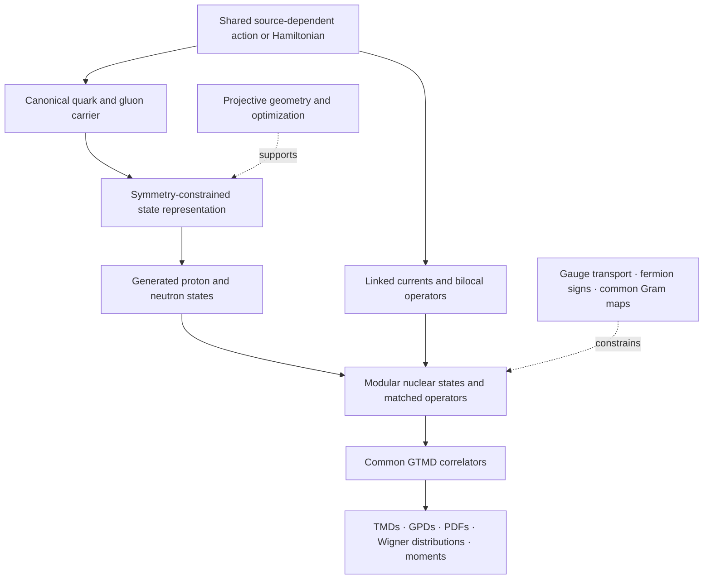

# QCD-QuantumGeometry

Quantum-state geometry, symmetry-preserving representations, and shared state–operator dynamics developed in the [DeuteronWigner project](https://github.com/uva-spin/DeuteronWigner).

The scientific goal is to generate proton and neutron structure from common dynamics, compose nuclei with variable baryon number, charge, and target spin, and calculate partonic and nuclear observables from consistent operators. The deuteron is the first spin-1 nuclear benchmark. Quantum geometry supplies representations, optimization tools, and information-preservation tests within that program.

**The implemented results are finite mathematical and computational controls.** They include a projective-state metric and natural-gradient solver, ordered SU(3) transport, fermionic nuclear composition, common overlap/operator maps, and linked state–interaction–source calculations. A physically qualified nonperturbative binding action, generated bound nucleons, and general nuclear predictions remain open.

## Read the work

| Guide | Contents |
| --- | --- |
| [Geometry and mathematical construction](docs/GEOMETRY.md) | Projective geometry, tensor-coordinate redundancy, non-Abelian transport, common Gram maps, and the distinction between several kinds of topology |
| [Results and scientific progression](docs/RESULTS.md) | What each investigation established, the decisive negative controls, and the limitations of the results |
| [Complete quantum tool catalog](docs/TOOL_CATALOG.md) | Every Python file in the 180-file quantum source snapshot, its public/local status, and available tests and replay scripts |
| [Using and extending the tools](docs/REUSE.md) | Dependencies, selected entry points, recorded reproduction commands, and requirements for reuse in a new representation |
| [Source provenance and publication status](docs/PROVENANCE.md) | Exact upstream revisions, what was already public, and the scope of this companion snapshot |

## The construction

The organizing dependency is a shared interaction producing states and matched operators, followed by common correlators and their observable reductions. Learning a state and learning effective dynamics are separate tasks whose consistency must be tested jointly.

This diagram describes the intended physical construction. Individual arrows have finite-domain implementations; the full predictive chain has not been completed.

Three responsibilities stay distinct:

| Responsibility | Objects | What validation establishes |
| --- | --- | --- |
| Physics | Action, degrees of freedom, vacuum, interactions, currents, matching | Whether a model supports the intended physical claims |
| Representation | Symmetry couplings, tensor connectivity, mode support, bond dimensions | What state and operator information is retained at a given cost |
| Solver | Classical contraction, quantum circuits, neural parameters, geometric updates | Whether the supplied model is being solved reliably |

## Core reusable tools

### Projective geometry and quantum natural gradients

For a normalized state, the implemented metric removes the physically irrelevant overall phase from parameter derivatives:

$$
B_a=(I-|\psi\rangle\langle\psi|)\partial_a\psi,
\qquad g_{ab}=\operatorname{Re}(B_a^\dagger B_b).
$$

The full complex tree circuit admits an exact interior inverse-metric action in linear time and storage in the represented dimension $D$. Its angle block is diagonal; its phase inverse is an incidence-matrix operation. State tangents and conversion back to gate coordinates are also implemented without forming a dense Jacobian.

The corresponding quantum natural-gradient solver uses executed PennyLane energies and gradients. In the recorded 37-state control, it reaches eigenpair residuals of $7.69\times10^{-9}$ and $8.33\times10^{-11}\,\mathrm{GeV}^2$ without seeding the exact eigenstate. Current measurements provide an additional check on the optimized state. The ansatz has $2(D-1)$ parameters, so linear storage in $D$ does not establish efficient scaling with the number of qubits or many-body compression.

Sources: [tree geometry](snapshot/src/deuteron_wigner/quantum/m2_tree_projective_geometry.py), [solver](snapshot/src/deuteron_wigner/quantum/m2_graph_natural_gradient.py), [recorded convergence result](evidence/m2_graph_convergence_result.md).

### Geometry that preserves operator information

The scalar representation study derives the geometry of an actual constrained low-rank coefficient family. It separates exact factor redundancy from weak numerical sensitivity, differentiates normalization and both current endpoints, and checks coordinate covariance.

A decisive example changes the reference state by only $2.59\times10^{-10}$ while changing a pair-current contribution by $2.05\times10^{-4}$. The core constraints and rank bound remain intact. State fidelity, normalization, and a small metric eigenvalue therefore do not by themselves justify deleting a direction from a shared state/operator representation.

Sources: [geometry implementation](snapshot/src/deuteron_wigner/quantum/scalar_representation_geometry.py), [complete audit](evidence/quantum_geometric_scalar_geometry.md).

### Ordered SU(3) transport and shared neural interactions

Gauge paths retain ordered matrices, their endpoint transformations, and their derivatives. Fixing a spanning-tree gauge preserves loop information when the remaining link matrices are retained. Two configurations can have the same separate elementary loop traces yet differ in the trace of a loop commutator; relative non-Abelian orientation carries information.

The same invariant functional generates all link responses. Separate controls distinguish a flexible real spatial potential from a positive temporal kernel: a positive-entry neural kernel can have negative eigenvalues, while a sufficient character-kernel construction has a positive-semidefinite guarantee.

Sources: [gauge network](snapshot/src/deuteron_wigner/quantum/modular_gauge_network.py), [architecture and executed controls](evidence/quantum_geometric_modular_architecture.md).

### Fermionic composition and the common Gram map

Sparse exterior algebra supplies exact quark exchange signs. Proton/neutron interpolators and SU(2) couplers support variable-composition finite examples. Overlapping composite states require their actual overlap matrix; their norms cannot be obtained by multiplying independently normalized nucleon factors.

If $E$ embeds composite coordinates in a common quark carrier, then $N=E^\dagger E$ determines the non-null physical coordinate space. The same map transports states, Hamiltonians, and every observable. The tested controls include exact Pauli-null directions and nontrivial orbital operators.

Sources: [baryon algebra](snapshot/src/deuteron_wigner/quantum/modular_baryon_algebra.py), [Gram-map result](evidence/quantum_geometric_modular_architecture.md#4-common-gram-map-normalization-and-every-operator-together).

### Canonical QCD nodes and actual path-created states

Canonical light-front field and graded-Fock utilities retain spin, flavor, color, mode normalization, and fermionic signs. Finite path dressings have been mapped into the existing quark/gluon carrier through second field order, including recoil, vacuum terms, and ordered two-gluon information.

The paths create overlapping states. They do not create independent orthogonal flux labels. A subsequent comparison shows that spin-blind path coordinates miss 9.41% of a reference canonical emission correction, while spin-diagonal coordinates miss 3.04%. Full Dirac tensors are therefore retained at interaction nodes. A fixed four-path dictionary also fails after a mode enlargement, demonstrating that a small-domain interpolation is not automatically a robust physical basis.

Sources: [canonical network](snapshot/src/deuteron_wigner/quantum/canonical_lf_network.py), [path-state result](evidence/lf_path_states.md), [Dirac correspondence](evidence/path_dirac_matching.md).

### Joint state and interaction learning

PennyLane/PyTorch controls distinguish variational state parameters from shared dynamical coefficients. Currents and higher source responses are derived from the same functional. The experiments expose both a good observable fit that fails its own state equation and an unresolved phase-sensitive dynamical direction that requires additional matching information.

A separate AV18 S/D-wave benchmark carries preserved nuclear information into a withheld $b_1$ calculation. Changing relative S/D coherence can leave forward unpolarized information unchanged while changing the tensor observable. Its input wavefunctions and nucleon PDFs are phenomenological inputs, not outputs of newly solved nucleon dynamics.

Source: [joint state/dynamics study](evidence/joint_state_dynamics.md).

## From reusable geometry to binding dynamics

The later work connects these tools to retained collective fields, chiral constraints, quantum currents, complete finite source waves, nuclear scalar/parton matching, and necessary binding controls. The [results guide](docs/RESULTS.md) records that sequence without treating every historical next action as an active task.

The latest numerical checkpoint represented here is a stable exploratory connection/chiral/sea class. A uniformly positive bounded coefficient of the full non-Abelian gauge kinetic term and a coercive chiral potential pass finite stability controls. The actual connection-dependent two-flavor determinant changes both the chiral branch and the connection response. Linked source derivatives and retained-fermion counting are checked.

The remaining physical qualification concerns the collective-field identity and measure, local Gauss law, canonical light-front embedding, spatial variation, anomaly/regulator requirements, and common source matching. Bound proton/neutron predictions and independent physical current-component comparisons follow that qualification. Nuclear composition and matched distributions then require their own dynamical and uncertainty tests.

Source: [stable connection/chiral/sea result](evidence/stable_connection_sea.md).

## Publication scope

This companion covers the local science checkpoint `dd0d7549` of September 11, 2026. The public upstream `main` checked on October 23, 2026 was `b6fbd042` of September 9. At that audit, upstream contained 135 quantum Python files; the local checkpoint contained 180. There were 45 added files and six modified existing files, with 129 identical files.

The early tree geometry, natural-gradient implementation, selected tests, and original architecture were already public. This companion makes the later tool inventory and recorded scientific results accessible alongside source snapshots. The snapshots preserve original numerical implementations for inspection; they are not a separately packaged, dependency-complete QCD library. See [provenance](docs/PROVENANCE.md) and [reuse](docs/REUSE.md).

## What remains open

- A physically qualified common binding action and vacuum, with generated proton and neutron states.
- Local gauge constraints, chiral/anomaly and regulator qualification, and independent bound-state current checks.
- Useful symmetry-preserving many-body compression with measured state **and** observable errors.
- Physically defined Berry/subspace transport or stronger topological claims, where justified by dynamics and observables.
- Matched nuclear/GTMD/TMD/GPD operators, subtraction, evolution, joint calibration, and withheld predictions.
- Classical/quantum cost comparisons at equal physical content and accuracy, including measurement and noise costs before hardware claims.

Projective geometry, symmetry intertwiners, Wilson transport, exterior algebra, effective-action matching, and generalized eigenvalue methods are established mathematical tools. The project-specific contributions are their explicit implementations, common-source and common-carrier constructions, and the positive and negative controls recorded here. References and historical qualifications are retained in the linked evidence notes.
